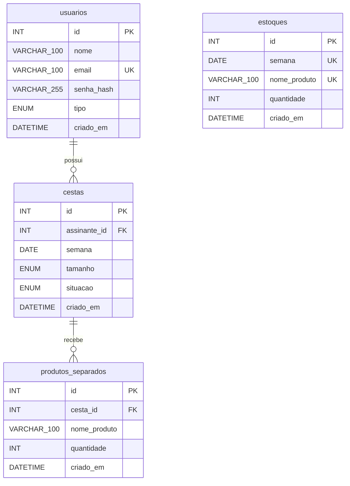

# DER — Cesta do Vale

O desenho documenta as três tabelas da cartilha e a tabela `estoques`, pedida depois pelo autor. O `email` (único) e o `senha_hash` entraram por
migration e aceitam `NULL` no banco só por causa dos cadastros feitos antes do login. Todo cadastro
novo exige os dois: o esquema Pydantic recusa a falta deles, e a senha é guardada só como hash Argon2.
A `semana` da cesta é a segunda-feira da semana do pedido, e a do estoque é a segunda-feira da semana da colheita.



`VARCHAR_100` representa `VARCHAR(100)`. Todas as tabelas usam InnoDB.
Um usuário pode ter nenhuma ou várias cestas; cada cesta tem um usuário.
Uma cesta pode ter nenhum ou vários produtos separados; cada produto tem uma cesta.
O `estoques` não tem chave estrangeira: o produto separado se liga a ele pelo `nome_produto` e pela `semana`
da cesta, conferidos no serviço. O par `semana` + `nome_produto` é único.
A comparação do nome usa a collation padrão do banco (`utf8mb4_0900_ai_ci`): ela ignora maiúsculas e também
acentos, então "Maca" e "Maçã" contam como o mesmo produto na mesma semana.

| Tabela | Coluna | Tipo MySQL | Restrição no banco |
| --- | --- | --- | --- |
| usuarios | id | INT | PK, AUTO_INCREMENT, NOT NULL |
| usuarios | nome | VARCHAR(100) | NOT NULL |
| usuarios | email | VARCHAR(100) | UNIQUE (uq_usuarios_email), NULL permitido |
| usuarios | senha_hash | VARCHAR(255) | NULL permitido; reservado para hash |
| usuarios | tipo | ENUM('assinante', 'produtor') | NOT NULL |
| usuarios | criado_em | DATETIME | NOT NULL, DEFAULT CURRENT_TIMESTAMP |
| cestas | id | INT | PK, AUTO_INCREMENT, NOT NULL |
| cestas | assinante_id | INT | FK → usuarios.id, NOT NULL |
| cestas | semana | DATE | NOT NULL |
| cestas | tamanho | ENUM('pequena', 'media', 'grande') | NOT NULL |
| cestas | situacao | ENUM('pedida', 'em_separacao', 'concluida', 'recusada') | NOT NULL, DEFAULT 'pedida' |
| cestas | criado_em | DATETIME | NOT NULL, DEFAULT CURRENT_TIMESTAMP |
| produtos_separados | id | INT | PK, AUTO_INCREMENT, NOT NULL |
| produtos_separados | cesta_id | INT | FK → cestas.id, NOT NULL |
| produtos_separados | nome_produto | VARCHAR(100) | NOT NULL |
| produtos_separados | quantidade | INT | NOT NULL |
| produtos_separados | criado_em | DATETIME | NOT NULL, DEFAULT CURRENT_TIMESTAMP |
| estoques | id | INT | PK, AUTO_INCREMENT, NOT NULL |
| estoques | semana | DATE | NOT NULL; UNIQUE com nome_produto (uq_estoques_semana_produto) |
| estoques | nome_produto | VARCHAR(100) | NOT NULL; UNIQUE com semana |
| estoques | quantidade | INT | NOT NULL |
| estoques | criado_em | DATETIME | NOT NULL, DEFAULT CURRENT_TIMESTAMP |

O esquema Pydantic recusa nomes vazios e quantidades que não sejam inteiros positivos.
O serviço verifica se o usuário é assinante, aplica os limites 5, 8 e 12 e muda a
situação na primeira separação. Essas validações não são restrições adicionais do banco.
Limite, ocupação e espaço restante são calculados, sem colunas correspondentes. Do mesmo jeito, o separado,
o disponível e o reservado do estoque são calculados a partir das cestas e dos produtos separados.

`ForeignKey` cria a restrição no MySQL; `Cesta.produtos_separados = relationship("ProdutoSeparado")`
permite ler os produtos no Python, sem criar outra coluna. Do mesmo jeito,
`Cesta.assinante = relationship("Usuario")` lê o dono da cesta pela `assinante_id`.

Confira no MySQL depois de executar `python criar_tabelas.py`:

```sql
DESCRIBE usuarios;
DESCRIBE cestas;
DESCRIBE produtos_separados;
DESCRIBE estoques;
SHOW CREATE TABLE produtos_separados;
```

O último comando deve mostrar a chave estrangeira `cesta_id` apontando para `cestas.id`.
`create_all` cria tabelas ausentes, mas não altera as existentes. Se a estrutura já
criada for diferente, preserve os dados e trate a mudança na aula de migrations.
